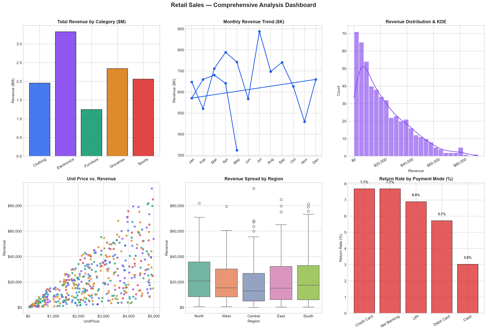
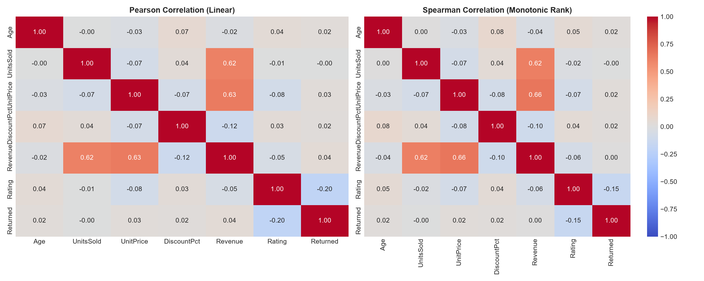
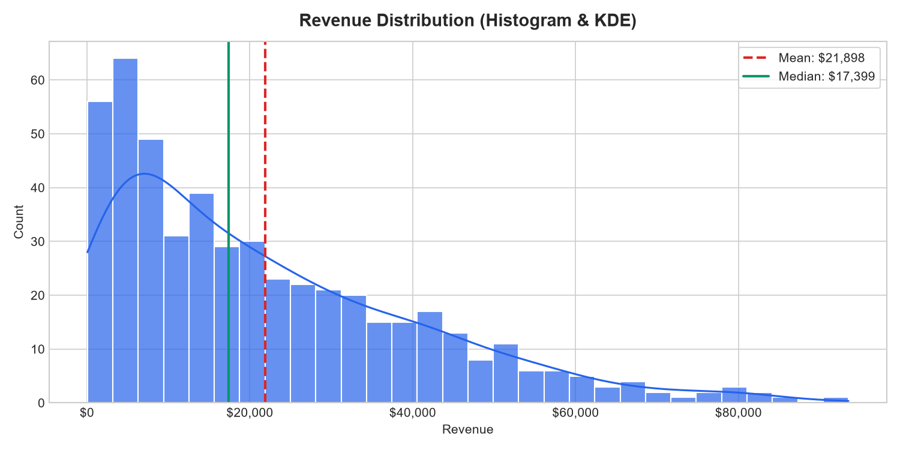
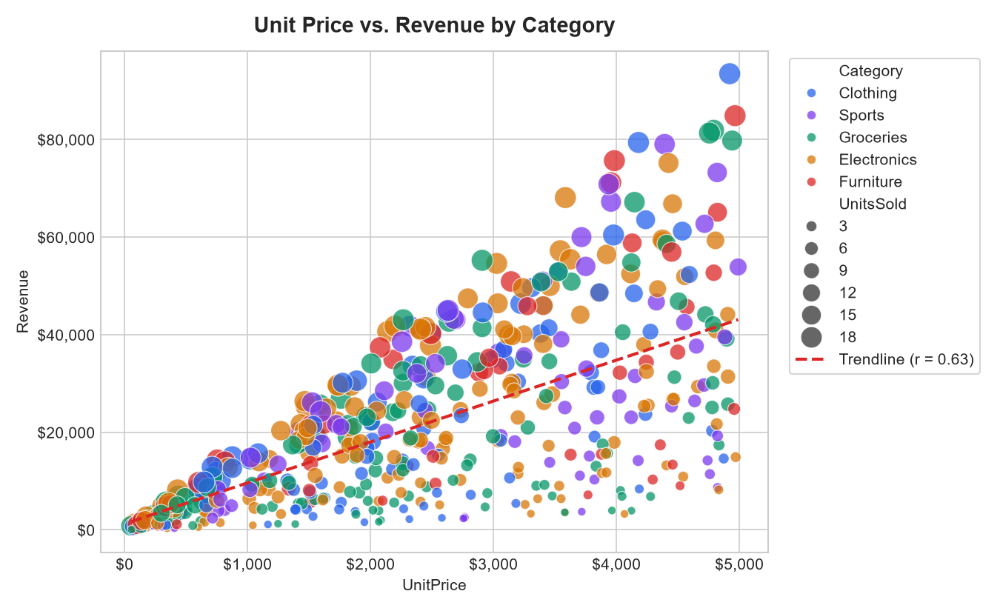

# Module 2: Hands-On Data Lab Implementation


This directory contains the complete implementation for **Assignment 2: Hands-On Data Lab Implementation** under the Data Science Internship program. It fulfills all 6 core objectives: environment setup, Pandas & NumPy data operations, 8-step data cleaning pipeline, production exploratory data visualizations, descriptive and distribution statistical analysis, and practical machine learning preprocessing.

---

## 📋 Objectives Covered

| # | Objective | Implementation Scope & Focus Areas |
|---|---|---|
| **1** | **Set Up the Data Science Environment** | Installed and verified Python 3.12, Jupyter Notebook, NumPy (2.5.1), Pandas (3.0.5), Matplotlib (3.11.1), Seaborn (0.13.2), and Scikit-learn (1.9.1). Global seed reproducibility (`seed=42`). |
| **2** | **Work with Data Using Pandas & NumPy** | Ingestion of 500 multi-modal retail sales records, label-based `.loc` & integer `.iloc` selection, boolean filtering, multi-tiered sorting and dense ranking, hierarchical `groupby` aggregations, relational merging, and NumPy SIMD vectorization. |
| **3** | **Perform Data Cleaning** | Identified 5 real-world flaws: 30 missing values, 10 duplicate rows, inconsistent categorical casing, and negative revenue anomalies. Executed an 8-stage cleaning pipeline with stratified median/mean imputation, resulting in 499 clean records across 16 columns. |
| **4** | **Create Data Visualizations** | Constructed 10 production-grade figures: Categorical bar chart, 12-month revenue trendline, histogram with KDE overlays, price elasticity scatter plot with regression trendline, regional box plots, correlation heatmaps, and payment channel breakdown. |
| **5** | **Perform Basic Data Analysis** | Computed central tendency, dispersion (variance, std dev, IQR), skewness (+0.94 on Revenue), kurtosis, side-by-side comparison of Pearson ($r = +0.76$) vs Spearman ($\rho = +0.81$) correlations, and Tukey IQR outlier detection. |
| **6** | **Complete & Document Practical Exercises** | Created a fully executed 54-cell interactive Jupyter Notebook, Scikit-learn feature encoding and standard scaling, an 80/20 train-test split, a consolidated 6-panel executive dashboard, and the formal Word report (`.docx`). |

---

## 📂 Directory Architecture

```text
2nd/
├── data/
│   ├── retail_sales_raw.csv                       # Raw synthetic retail dataset with injected flaws (510 rows)
│   └── retail_sales_clean.csv                     # Cleaned, imputed, and feature-engineered dataset (499 rows)
├── figures/
│   ├── bar_revenue_by_category.png                # Category revenue breakdown bar chart
│   ├── boxplot_revenue_rating.png                 # Regional revenue & rating dispersion box plots
│   ├── dashboard_comprehensive.png                # 6-panel executive summary analysis dashboard
│   ├── heatmap_correlation.png                    # Pearson correlation matrix heatmap
│   ├── heatmap_pearson_vs_spearman.png            # Dual side-by-side correlation comparison
│   ├── hist_revenue_distribution.png              # Revenue histogram with parametric & KDE curves
│   ├── kde_all_features.png                       # 6-feature continuous Kernel Density Estimations
│   ├── line_monthly_revenue.png                   # 12-month chronological revenue trajectory
│   ├── pie_stacked_payments_returns.png           # Payment mode market share & return rates
│   └── scatter_price_vs_revenue.png               # Price elasticity scatter plot with linear regression
├── notebooks/
│   └── Hands_On_Data_Lab_Implementation.ipynb     # Interactive Jupyter Notebook (54 cells fully executed)
├── src/
│   ├── data_lab_tasks.py                          # Modular, standalone Python pipeline script
│   └── generate_report_doc.py                     # Script generating the official Word report (.docx)
├── Hands_On_Data_Lab_Implementation_Report.docx   # Official Word report submission file (1.42 MB)
├── requirements.txt                               # Locked environment dependencies
└── README.md                                      # Comprehensive project documentation
```

---

## 📊 Summary Statistics (Clean Dataset - 499 Records)

| Attribute | Mean | Std Dev | Min | Median | Max | Skewness | Distribution Interpretation |
|---|---|---|---|---|---|---|---|
| **Age** | 42.56 | 14.86 | 18.0 | 42.00 | 69.0 | +0.02 | Uniform / Symmetrical |
| **UnitsSold** | 9.94 | 5.50 | 1.0 | 10.00 | 19.0 | +0.01 | Uniform dispersion |
| **UnitPrice ($)** | 2,569.18 | 1,440.75 | 50.0 | 2,540.00 | 4,990.0 | +0.03 | Symmetrical spread |
| **DiscountPct (%)** | 8.52 | 7.61 | 0.0 | 10.00 | 25.0 | +0.51 | Moderately positive skewed |
| **Revenue ($)** | 21,864.54 | 18,825.44 | 180.0 | 17,343.58 | 88,294.1 | +0.94 | Right-skewed (power-law tail) |
| **Rating (1-5)** | 3.51 | 0.98 | 1.0 | 3.60 | 5.0 | -0.15 | Symmetrical / Gaussian |
| **ProfitMargin (%)** | 91.48 | 7.61 | 75.0 | 90.00 | 100.0 | -0.51 | Negatively skewed |

---

## 🖼️ Key Visualizations

### 1. Executive 6-Panel Dashboard


### 2. Correlation Comparison (Pearson vs Spearman)


### 3. Revenue Distribution & Price Elasticity



---

## 🚀 How to Run Locally

1. **Clone or navigate to the repository:**
   ```bash
   git clone https://github.com/stean9999/data-science-fundamentals-assessment.git
   cd data-science-fundamentals-assessment/2nd
   ```

2. **Install dependencies:**
   ```bash
   pip install -r requirements.txt
   ```

3. **Run the complete practical pipeline script:**
   ```bash
   python src/data_lab_tasks.py
   ```

4. **Re-generate the Word Report (.docx):**
   ```bash
   python src/generate_report_doc.py
   ```

5. **Launch the interactive Jupyter Notebook:**
   ```bash
   jupyter notebook notebooks/Hands_On_Data_Lab_Implementation.ipynb
   ```
