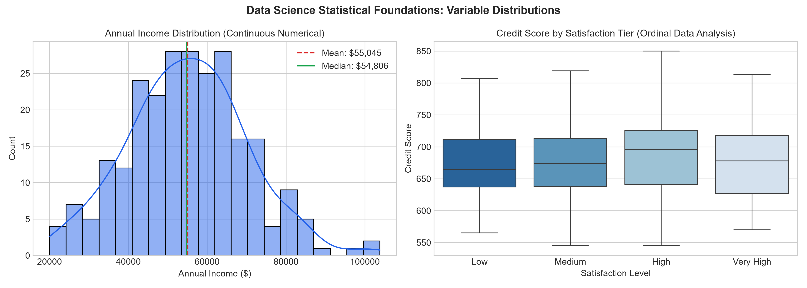
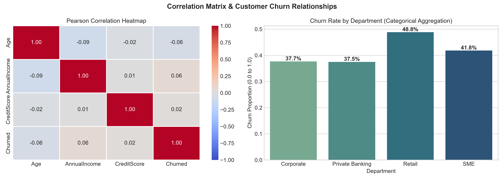

# Data Science Fundamentals Assessment


This repository contains the comprehensive submission for the **Data Science Fundamentals Assessment**. It implements theoretical concepts, mathematical formulations, statistical modeling, data handling strategies, and clean Python programming practices into a reproducible analytical project.

---

## 📋 Objectives Covered

| # | Objective | Focus Areas |
|---|---|---|
| **1** | **Data Science Fundamentals** | Life cycle (CRISP-DM/OSEMN), 4 analysis types (Descriptive, Diagnostic, Predictive, Prescriptive), industry use cases (Finance, Healthcare, E-commerce, Manufacturing). |
| **2** | **Python Programming Basics** | Variables, primitive types, operators, conditional branching, loops, functions, lists, tuples, dictionaries, sets, context-managed file handling. |
| **3** | **Statistical Foundations** | Measures of central tendency (Mean, Median, Mode), dispersion (Variance, Std Dev, IQR), percentiles, probability basics, Pearson vs Spearman correlation. |
| **4** | **Data Types & Structures** | Numerical (discrete/continuous), Categorical (nominal/ordinal), Datetime parsing, Text data preprocessing, encoding strategies (One-Hot, Ordinal), scaling. |
| **5** | **Data Science Best Practices** | Clean code (PEP 8), meaningful naming, reproducible environments (`requirements.txt`, random seeds), data integrity, ethics, bias mitigation. |
| **6** | **Practical Assignments** | Synthetic multi-modal dataset generation (250 observations), statistical evaluation, empirical visualizations, and reporting. |

---

## 📂 Project Architecture

```text
├── data/
│   └── customer_churn_sample.csv          # Multi-modal banking dataset (250 records)
├── figures/
│   ├── distribution_plots.png             # Density & ordinal boxplot visualizations
│   └── correlation_matrix.png             # Correlation heatmap & departmental churn
├── notebooks/
│   └── Data_Science_Fundamentals_Assessment.ipynb  # Interactive Jupyter Notebook
├── src/
│   ├── fundamentals_tasks.py              # Main practical Python execution script
│   ├── generate_report_doc.py             # Script generating Word (.docx) report
│   └── generate_notebook.py               # Script creating structured notebook
├── Data_Science_Fundamentals_Assessment_Report.docx # Official Word report submission
├── requirements.txt                       # Locked dependencies
├── .gitignore                             # Ignored artifacts & cache
└── README.md                              # Comprehensive project documentation
```

---

## 📊 Key Findings & Empirical Results

### Summary Statistics Table
| Feature | Mean | Median | Mode | Std Dev | Q1 (25%) | Q3 (75%) | Skewness |
|---|---|---|---|---|---|---|---|
| **Annual Income ($)** | 55,045.48 | 54,806.02 | 20,000.00 | 15,013.89 | 44,888.54 | 64,089.52 | 0.18 |
| **Credit Score** | 680.34 | 682.50 | 664.00 | 60.52 | 637.00 | 720.00 | 0.10 |
| **Age (Years)** | 43.56 | 44.00 | 61.00 | 15.31 | 31.00 | 56.00 | -0.06 |

### Correlation Insights
- **Pearson Correlation (Linear):** $r = +0.0067$
- **Spearman Correlation (Rank):** $\rho = +0.0113$
- *Interpretation:* The near-zero correlation between annual income and credit score indicates that debt repayment reliability operates independently of gross earning levels in this customer portfolio.

---

## 🖼️ Visualizations

### 1. Distributions & Ordinal Boxplots


### 2. Correlation Matrix & Churn Breakdown


---

## 🚀 How to Run the Project Locally

1. **Clone the repository:**
   ```bash
   git clone https://github.com/<your-username>/data-science-fundamentals-assessment.git
   cd data-science-fundamentals-assessment
   ```

2. **Create and activate a virtual environment:**
   ```bash
   python -m venv venv
   # On Windows:
   .\venv\Scripts\activate
   # On Linux/macOS:
   source venv/bin/activate
   ```

3. **Install dependencies:**
   ```bash
   pip install -r requirements.txt
   ```

4. **Execute the practical assignment script:**
   ```bash
   python src/fundamentals_tasks.py
   ```

5. **Generate the Word (.docx) report:**
   ```bash
   python src/generate_report_doc.py
   ```

6. **Launch Jupyter Notebook:**
   ```bash
   jupyter notebook notebooks/Data_Science_Fundamentals_Assessment.ipynb
   ```

---

## 📜 Submission Deliverables

- **Official Word Report:** [Data_Science_Fundamentals_Assessment_Report.docx](Data_Science_Fundamentals_Assessment_Report.docx)
- **Interactive Notebook:** [notebooks/Data_Science_Fundamentals_Assessment.ipynb](notebooks/Data_Science_Fundamentals_Assessment.ipynb)
- **Dataset:** [data/customer_churn_sample.csv](data/customer_churn_sample.csv)
